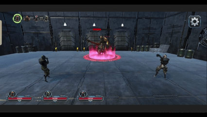

# Conquer The Stars

> **3D Turn-Based RPG for Android** — a solo Unity/C# portfolio project combining tactical decisions with timed attacks, dodging, and blocking. Designed for landscape touchscreen play.

## 🎮 Demo

[Download](https://pakbot4124.itch.io/conquer-the-stars) · [Gameplay Video](https://youtu.be/o_B0CL_cYfI) · [Developer Logs](https://app.notion.com/p/Conquer-The-Stars-3e3fa5c6075a8146b565d8ba530a15e4?source=copy_link)

<p align="center">
  
  
  
</p>

## 📖 Overview

Lead a team through turn-based encounters, choose skills and targets, and react to enemy attacks. Earn EXP and items from victories, manage your squad's equipment, and save your progression between sessions.

**Status:** In development — current focus: Android validation, combat balancing, and portfolio documentation. Planned additions include graphics settings and more item types.

## ⚔️ Key Systems

- **Combat** — Speed-based initial turn order, turn stealing, skill/target selection, timed attacks, and reactive dodge/block mechanics.
- **Enemy AI & Bosses** — Weighted target evaluation using HP, threat, and defense; health-based boss phase changes.
- **Items & Buffs** — Healing, mana recovery, revival, and temporary stat buffs; quantity tracking and out-of-stock restrictions.
- **Equipment** — Drag-and-drop equipping, unequipping, stat bonuses, and inventory quantity updates; replacing equipment returns the previous item to inventory.
- **Progression & Rewards** — Victory rewards include EXP and items; multi-level advancement, level-based stats, and a battle results panel.
- **Save / Load** — JSON persistence for checkpoint position, team level/EXP, consumables, equipment inventory, equipped slots, and completed battles; New Game resets progression and restores encounters.

## 🛠️ Technical Highlights

- **State Machines** — Separate battle-flow and actor state machines coordinate selection, execution, and results.
- **Data-Driven Design** — ScriptableObjects configure stats, attacks, items, enemy teams, rewards, and AI evaluation weights.
- **Reusable Systems** — Factory-based item effects and enum-keyed pooling for actors, VFX, and UI, with return-to-pool parenting and lifecycle cleanup.
- **Scene Flow** — A dedicated loading scene routes transitions through asynchronous scene loading.

**Built with:** Unity **6000.3.8f1** · C# · URP · Input System · Cinemachine · Unity UI

**Validation:** Targets 30 FPS on Android. Earlier builds have been tested on a physical device; performance measurements and regression validation for the latest changes are pending. The repository includes EditMode tests for character stats, enemy target evaluation, turn order, and save/load.

## 🎯 Controls

**Android — landscape orientation**

| Action | Input |
|---|---|
| Move | On-screen movement control |
| Select actions, items, and targets | On-screen combat controls |
| Time an attack | Tap as the timing rings align |
| Dodge | Swipe vertically on the right side of the screen |
| Block | Swipe vertically on the left side of the screen |
| Equip an item | Drag an available item onto a squad member's equipment slot |

## 📂 Project Structure

```text
Assets/Scripts/
├── Fight/             # Battle setup, turn order, AI, and team management
├── Input/             # Exploration and combat input
├── Managers/          # Game flow, audio, and UI coordination
├── Pattern/           # State machines, object pooling, and item factory
├── Save/              # JSON persistence and save data
├── ScriptableObject/  # Gameplay configuration assets
├── Stats/             # Character stats and level scaling
├── UI/                # Menus, combat HUD, inventory, equipment, and loading
└── VFX/               # Visual effects logic
```

## 🚀 Run Locally

**Asset dependencies:** The `Assets/Third_party Assets/` folder is ignored by Git. A fresh clone is suitable for source review, but is not a complete, ready-to-run project. See the [asset inventory and restoration notes](THIRD_PARTY_ASSETS.md) for package names, local versions, and unresolved dependencies. Matching assets and references must be restored before the original scenes can run correctly. To try the game without setting up the project, use the Android download above.

1. Clone the repository and open it with **Unity 6000.3.8f1**.
2. Allow packages to resolve, restore the required third-party assets with their expected GUIDs/references, and check for missing scripts or asset references.
3. Open `Assets/Scenes/Start.unity` and press **Play**.
4. Choose **New Game**, or **Continue** if a save exists.

## 👨‍💻 Developer & Credits

Developed by [Phạm Anh Khoa](https://github.com/khoaPA41). Personal implementation work includes combat, battle/actor state machines, weighted enemy targeting, object pooling, inventory/equipment, and UI integration. FSM and pooling were informed by learning references; save/load was adapted from reference material to fit the project.

Third-party art, animations, UI, audio, and VFX assets belong to their respective creators. This portfolio focuses on gameplay programming and system integration, not original asset creation.

Special thanks to the creators whose assets support this project:

- **Environment & animation:** Sickhead Games — Sci-Fi Construction Kit (Modular); Lukas Bobor — Sci fi Drones; WM_Animset — TransformAnimation SXB.
- **UI:** 3d.rina — Sci-fi GUI skin; Wenrexa — Interface UI KIT #4; Austin Windsor — Dynamic Floating Text.
- **Audio:** Daniel SoundsGood — Free Deadly Kombat; Phat Phrog Studio — Free Sci-Fi Music Collection; ULTRA FORGE STUDIO — ambient/lo-fi sci-fi music; TII — sci-fi sound library.
- **VFX:** Hovl Studio — Magic Effects FREE; Mirza Beig — Distortion Shockwaves VFX; Vefects — Easy Shockwaves VFX and Wind VFX.

The [full asset inventory](THIRD_PARTY_ASSETS.md) also covers other imported packs, fonts, bundled samples, and assets whose original source still needs confirmation. Credits do not grant redistribution rights; each asset remains subject to its own license.

